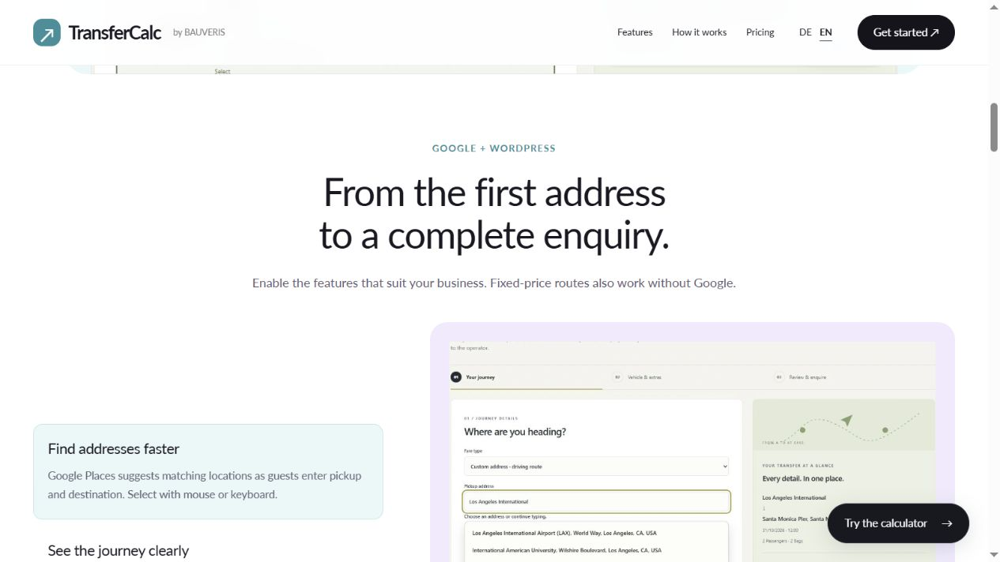

# TransferCalc

A WordPress plugin for transfer fares and ride enquiries. It combines configurable fixed-route prices with optional road-distance calculations, vehicle selection and a structured enquiry workflow.

## Features

- Fixed-price routes with vehicle-specific prices and capacity checks
- Optional Google Routes distance-based fares with base, per-kilometre and minimum-price rules
- Return journeys, night surcharges and once-per-enquiry extras
- German and English interfaces
- Saved enquiries, admin status updates, CSV export and configurable retention
- Internal email notifications through WordPress mail delivery
- Optional address suggestions and click-loaded maps

Calculations use integer minor currency units. A ride enquiry is not an automatic booking confirmation and does not reserve vehicle availability.

## Install

Requires **WordPress 6.5+** and **PHP 8.1+**. No Elementor, WooCommerce or special theme is required.

1. Zip the `transferpilot` folder and upload it through **Plugins → Add Plugin → Upload Plugin**.
2. Activate the plugin and open **TransferPilot → Setup**.
3. Configure the business name, notification recipient, privacy URL, currency and operator timezone.
4. Add locations, vehicle classes and fixed-price routes.
5. Place `[transferpilot]` on a page.

The folder, shortcode and internal PHP identifiers retain the original `transferpilot` name for compatibility; the product is presented as TransferCalc.

## Optional services

Fixed-price routes work without Google. Distance-based routing needs the operator's own Google Cloud account, billing and API credentials. Google Routes, Places suggestions and browser maps have separate setup requirements and may incur provider charges. See [Google configuration](transferpilot/GOOGLE-FUNKTIONEN-DE-EN.txt).

Email uses `wp_mail`. Configure the site's SMTP or mail provider and verify delivery to the intended mailbox before accepting customer enquiries. API credentials, recipient addresses and live customer records are not bundled with this repository.

## Structure

| Location | Purpose |
| --- | --- |
| `transferpilot/transferpilot.php` | Plugin bootstrap and activation |
| `transferpilot/includes/` | Fare rules, API handlers, administration and diagnostics |
| `transferpilot/assets/` | Public interface scripts and styles |
| `transferpilot/languages/` | German and English interface text |
| `transferpilot/uninstall.php` | Uninstall behaviour |

## Operation

Protect the WordPress database and backups. Configure provider restrictions and usage limits for API keys. Test fare rules, capacity limits, return journeys, notifications and privacy text after configuration changes. Single-site WordPress is supported; multisite network activation is not included.

## Licence

Developed by **Steffen Riesberg · BAUVERIS**. GPL-2.0-or-later; see [LICENSE.txt](LICENSE.txt). Third-party services remain subject to their own terms.

[Product overview](https://bauveris.de/transfercalc/) · [Contact BAUVERIS](https://bauveris.de/en/contact/)
